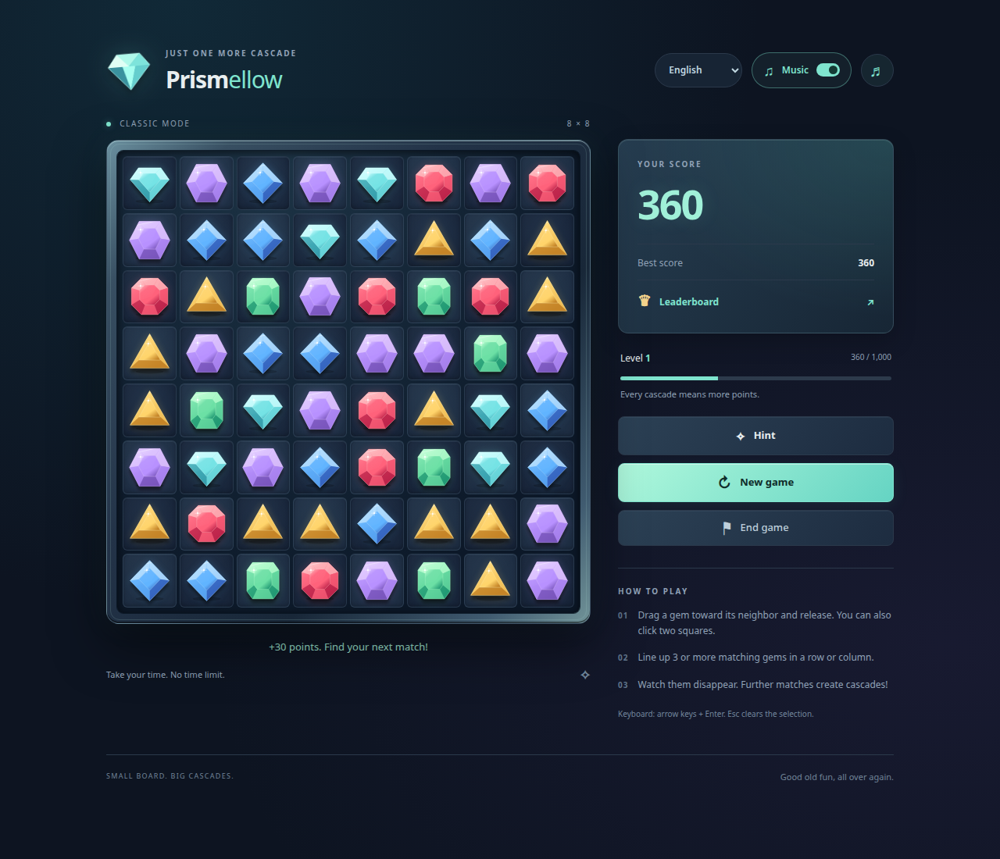

# Prismellow

I felt nostalgic for the gem-matching games I used to play. I wanted to enjoy that
simple loop again: swap neighboring gems, match three, and watch new stones fall
into place. So I described the mechanics from memory and built my own free, local
browser game with Codex.

I started with a playable prototype implemented by Codex. I played it, asked for
changes, and repeated that cycle as the graphics, dragging, music and crystal
chimes took shape. Prismellow grew through those small iterations.

## Play

[Play online on GitHub Pages](https://jaroslawkepka.github.io/vibe-coding-playground/01-prismellow/).

To play offline, copy this folder and open `index.html` in your browser.
No installation or server is needed.

Click or drag neighboring gems to match three or more. Enjoy cascades, hints,
optional music and sound effects, and an English, Polish or German interface.
English is the default, and the game remembers your language choice.
A game ends when no legal moves remain or when you choose **End game**.

The local Top 10 and preferences belong to your browser profile. Copying the folder
does not transfer scores; storage availability depends on the browser.

[Development process](docs/DEVELOPMENT_PROCESS.md) ·
[Documented outcomes](AI_TRANSFORMATION_OUTCOMES.md)

Licensed under the [MIT License](LICENSE).
