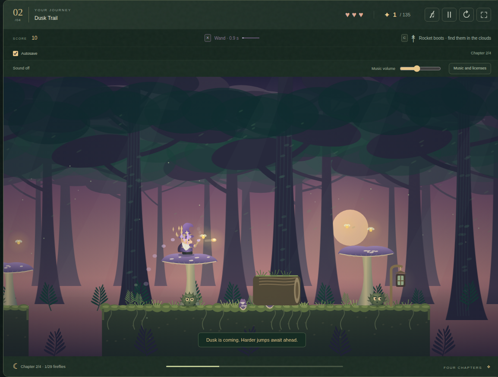

# Vibe Coding Playground

Small projects I build in short iterations with Codex, an AI coding agent.

## Documentation responsibilities

| File or folder | Responsibility |
| --- | --- |
| `README.md` | Introduce the playground and link to its projects. |
| `AGENTS.md` | Define shared rules for AI-assisted development, verification and documentation. |
| `methodology/` | Hold the shared outcome template and general playbook. |
| [Outcome template](methodology/AI_TRANSFORMATION_OUTCOMES_TEMPLATE.md) | Provide the section structure for a case study. |
| [Outcome playbook](methodology/AI_TRANSFORMATION_OUTCOMES_PLAYBOOK.md) | Explain evidence, estimates and case review. |
| Numbered project folders | Contain each project's implementation and public records. |
| Project `README.md` | Tell the project's story and explain how to run it. |
| Project `AGENTS.md` | Add project-specific rules to the shared agent instructions. |
| Project `AI_TRANSFORMATION_OUTCOMES.md` | Present one concise, filled case study with results and evidence. |
| Project `docs/` | Hold additional process records, screenshots and verification instructions where useful. |

Each project keeps its filled outcome case at the top level. Additional records
and screenshots belong in `docs/`. Both games open from their own `index.html`.

## 01 — Prismellow

Prismellow is a match-three game I built with Codex from memories of games
I used to play. Swap and drag gems across a large board, enjoy falling cascades
and crystal chimes, and keep your best scores in a local Top 10. The game includes
original music and an English, Polish or German interface.
To play offline, copy `01-prismellow/` and open `index.html`;
no server or installation is needed.

[Play online on GitHub Pages](https://jaroslawkepka.github.io/vibe-coding-playground/01-prismellow/) · [Instructions](01-prismellow/README.md) ·
[Development process](01-prismellow/docs/DEVELOPMENT_PROCESS.md) ·
[AI Transformation Outcomes](01-prismellow/AI_TRANSFORMATION_OUTCOMES.md)

This completed game was imported after its original development session.
Intermediate code versions were not committed separately.

## 02 — Wandmoss Journey

Wandmoss Journey is a fairy-tale platformer I built with Codex, starting with
one forest level and expanding through my tests and feedback. Guide a dwarf
wizard through four chapters, take to the clouds with rocket boots, and face
the Guardian of the Valley. The game includes local autosave, keyboard and
touch controls, an English, German or Polish interface, and music by Kevin MacLeod.
To play offline, copy `02-wandmoss-journey/` and open `index.html`;
no server or installation is needed.

[Play online on GitHub Pages](https://jaroslawkepka.github.io/vibe-coding-playground/02-wandmoss-journey/) · [Instructions](02-wandmoss-journey/README.md) ·
[Development process](02-wandmoss-journey/docs/DEVELOPMENT_PROCESS.md) ·
[AI Transformation Outcomes](02-wandmoss-journey/AI_TRANSFORMATION_OUTCOMES.md)

The game and documentation are published, and the project is complete.
I tested the final online version, including on a physical phone.
Original code and artwork use MIT; the recordings use CC BY 4.0, with
[separate notices](02-wandmoss-journey/THIRD_PARTY_NOTICES.md).
